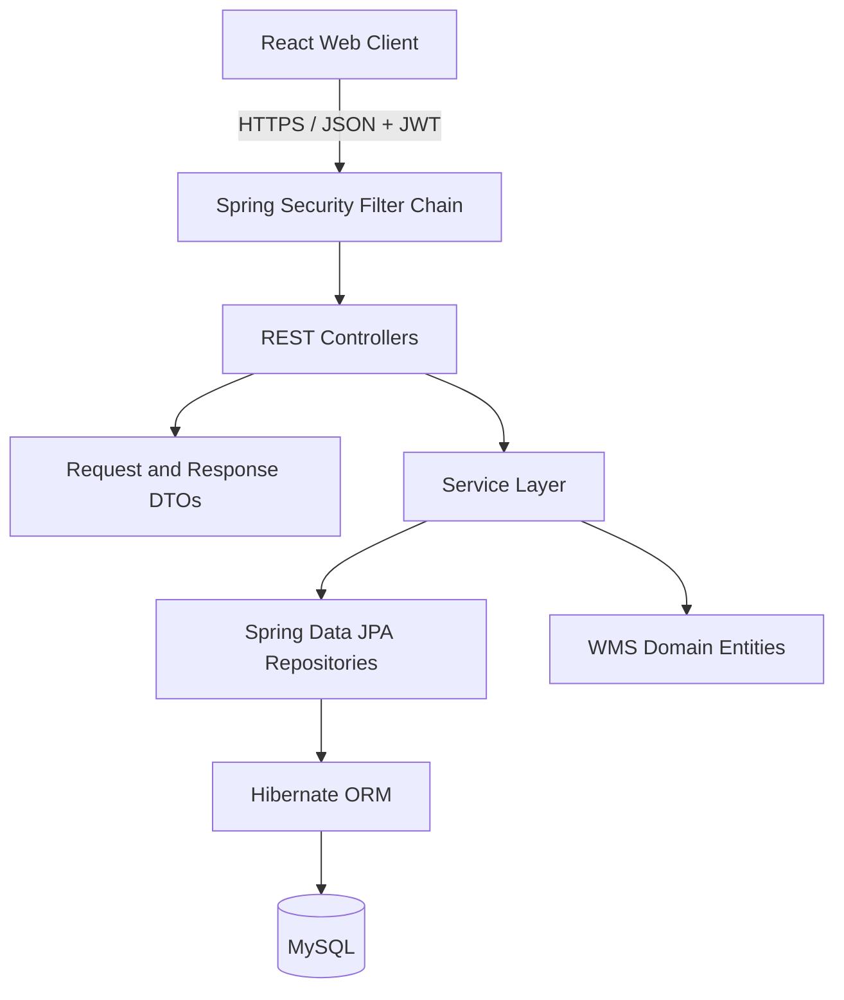

# ZiroLogistics — Backend API

ZiroLogistics is an independent Warehouse Management System (WMS) project. This repository contains the Java/Spring Boot REST API; the web client is maintained separately.

## Related repository

- Frontend: [ZiroLogistics-Frontend](https://github.com/Youuzzi/ZiroLogistics-Frontend)

## Technology

| Area | Technology |
|---|---|
| Language | Java 21 |
| Framework | Spring Boot 3.5.13 |
| API | Spring Web |
| Authentication / authorization | Spring Security, JWT |
| Persistence | Spring Data JPA / Hibernate |
| Database | MySQL |
| Tests | Spring Boot Test, Spring Security Test, H2 |
| Build | Maven |

## Functional areas

The source is organized around these WMS capabilities:

- Authentication and role-based authorization.
- Warehouse and storage-bin management.
- Item catalog management.
- Inbound and outbound stock movements.
- Stock transfer between bins.
- Inventory stock queries and movement ledger.
- Dashboard summary.

See the controllers, request/response DTOs, services, and repositories for the current API contract. The API reference is being documented from the implementation so endpoint names and payloads are not guessed.

## Architecture



The application follows a layered backend structure. Controllers expose HTTP endpoints, services coordinate business operations, repositories handle persistence, and JPA entities represent stored domain data.

## Project structure

```text
src/main/java/
├── config/       Security, web, and auditing configuration
├── controller/   REST controllers
├── entity/       JPA entities and shared audited base entity
├── exception/    Application exceptions and API error handling
├── filter/       JWT request filter
├── repository/   Spring Data JPA repositories
├── io/
│   ├── request/  Request DTOs
│   └── response/ Response DTOs
├── service/      Business service interfaces and implementations
└── util/         JWT utilities
```

## Run locally

### Requirements

- Java 21
- MySQL 8.x
- Maven

### Database

Create a local database:

```sql
CREATE DATABASE ziro_logistics;
```

Configure the datasource using your local credentials. Do not commit real passwords, tokens, or other secrets.

Example datasource properties:

```properties
spring.datasource.url=jdbc:mysql://localhost:3306/ziro_logistics
spring.datasource.username=YOUR_USERNAME
spring.datasource.password=YOUR_PASSWORD
```

Run the application:

```bash
mvn spring-boot:run
```

## Testing status

The current test source contains a Spring application-context smoke test using the test profile and H2. This verifies application context startup only; it is not evidence of full endpoint, authorization, inventory workflow, concurrency, or idempotency coverage.

Run the test suite with:

```bash
mvn test
```

## Documentation

- [Architecture overview](docs/architecture.md)
- [Testing evidence and limitations](docs/testing.md)

The API endpoint catalogue, entity relationship diagram, and detailed workflow documentation will be expanded after the corresponding source classes and mappings are verified.

## Project status

Independent project — under active development and documentation refinement.

## Developer

**Yozi Heru Maulana** — [GitHub](https://github.com/Youuzzi)
