# Architecture Overview

## System context

ZiroLogistics is split into two independently maintained repositories:

- **Frontend:** React 19 + Vite web client.
- **Backend:** Java 21 + Spring Boot 3.5.13 REST API.
- **Persistence:** MySQL through Spring Data JPA / Hibernate.

```mermaid
flowchart LR
    Operator[Warehouse Operator] --> Browser[Web Browser]
    Browser --> React[React 19 + Vite]
    React -->|JSON requests + JWT| API[Spring Boot REST API]
    API --> Security[Spring Security]
    Security --> Controllers[REST Controllers]
    Controllers --> Services[Business Services]
    Services --> Repositories[Spring Data JPA]
    Repositories --> Hibernate[Hibernate]
    Hibernate --> MySQL[(MySQL)]
```

## Backend layers

| Layer | Responsibility |
|---|---|
| Controller | HTTP boundary and request handling |
| Request / response DTO | API input and output models |
| Service | Application and WMS business operations |
| Repository | Persistence access |
| Entity | JPA-persisted domain state |
| Security filter / configuration | Request authentication and endpoint authorization |
| Exception handling | Consistent application error handling |

## Functional domains

The repositories describe these application areas:

1. Authentication and role-based access.
2. Warehouse and bin configuration.
3. Item catalog.
4. Inbound stock movement.
5. Outbound stock movement.
6. Bin-to-bin stock transfer.
7. Inventory stock and movement ledger.
8. Dashboard summary.

## Data model documentation status

A physical ERD must be generated from the actual JPA entity annotations and relationship mappings. It is intentionally not fabricated in this overview. Once entity source inspection is complete, the ERD should include table names, primary keys, foreign keys, cardinality, nullable relationships, and delete behavior.

## API contract documentation status

The endpoint catalogue should be extracted from the actual controller mappings and DTO fields. Until that source-level inventory is complete, this document does not invent HTTP paths, payload examples, or response codes.
