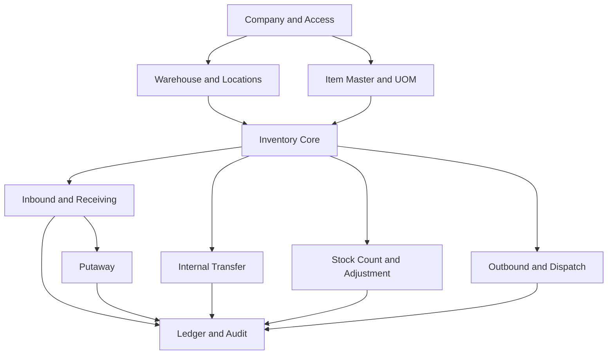

# WMS Business Domain & Capability Model

- **Document ID:** DB-02
- **Version:** 0.1
- **Status:** Proposed — capability baseline for review
- **Parent:** DB-01 WMS Database Architecture
- **Product stage:** Initial release for small and medium warehouses

## 1. Purpose

This document defines the business domains and capability scope that should guide the first ZiroLogistics WMS database design.

It separates:
- capabilities required for a useful small/medium warehouse management product;
- capabilities that may be introduced as the product grows; and
- enterprise-oriented capabilities that must not inflate the first release without a demonstrated requirement.

A capability listed here is not automatically an implemented feature or a database table. The final logical data model must represent approved business concepts and lifecycle rules.

## 2. Product scope and design principles

### 2.1 Initial product target

The initial product is intended for one organization/company operating one or more small or medium warehouses.

The first release should provide reliable control over:
- warehouse and storage-location master data;
- item and unit-of-measure master data;
- receiving and putaway;
- stock visibility by item and location;
- internal stock movement;
- stock adjustment and stock counting;
- outbound order handling, picking, and dispatch;
- user access and operational accountability;
- inventory history and reconciliation.

The product should be configurable enough for different warehouse layouts and operating practices without requiring a complex enterprise rules engine.

### 2.2 Design principles

1. Model real business ownership and lifecycle, not just screens or CRUD endpoints.
2. Separate master data, business documents, execution tasks, and posted inventory effects.
3. A document being created or approved must not silently imply that stock has physically moved.
4. Every stock-changing operation must have a traceable posting event.
5. A retry must not post the same movement twice.
6. Inventory availability must be defined, not inferred from a single quantity column.
7. Do not permit destructive edits to posted inventory history.
8. Keep first-release workflows understandable and operationally testable.
9. Add complexity only when it solves an identified operational problem.
10. Keep the model extensible without claiming future capabilities already exist.

## 3. Domain map

| Domain | Business responsibility | Main concepts |
|---|---|---|
| Organization & Access | Define company ownership and who may operate each warehouse | Company, User, Role, Permission, User-Warehouse Assignment |
| Warehouse Master | Define warehouse facilities and their storage structure | Warehouse, Zone, Location, Location Type |
| Item Master | Define stored products and their handling/measurement rules | Item, SKU, Category, Barcode, UOM, UOM Conversion |
| Inventory | Track quantity and status at a storage location | Inventory Balance, Inventory Status, Inventory Ledger |
| Inbound | Receive goods into warehouse custody | Inbound Receipt, Receipt Line, Receiving Result |
| Putaway | Move received goods to their storage location | Putaway Task, Putaway Confirmation |
| Internal Movement | Move stock between locations or warehouses | Transfer, Transfer Line, Movement Confirmation |
| Stock Control | Correct and verify recorded inventory | Adjustment, Count Session, Count Result |
| Outbound | Fulfil demand and dispatch goods | Outbound Order, Order Line, Reservation, Pick, Shipment |
| Audit & Integration | Preserve evidence and safely process repeated requests | Audit Event, Idempotency Key, External Reference |

These are logical business domains, not a prescribed microservice structure. The backend remains a modular monolith unless a later, evidence-based architecture decision says otherwise.

## 4. Capability classification

### 4.1 Initial release — P0

| Capability | Purpose | Required business outcome |
|---|---|---|
| Company and user access | Establish ownership and accountable actors | A user can operate only within authorized company/warehouse scope |
| Warehouse master | Register multiple warehouses | Every operational location belongs to a known warehouse |
| Location master | Define storage locations | Stock can be identified at a specific location |
| Item master | Register stock keeping units | Inventory is consistently identified and measured |
| UOM policy | Define base and permitted transaction units | Quantity entry and conversion are predictable |
| Inbound receiving | Record goods physically received | Received quantity and discrepancies are traceable |
| Putaway confirmation | Record movement from receiving/staging to storage | Stock is assigned to its actual storage location |
| Inventory visibility | Query balances by item, warehouse, location, and status | Staff can determine where stock is recorded |
| Internal transfer | Move stock between locations | Source and destination effects are consistent |
| Stock adjustment | Correct verified discrepancies with reason | Corrections are attributable and auditable |
| Stock count | Compare physical count with system balance | Variances are reviewed and posted under controlled rules |
| Outbound processing | Prepare and fulfil goods leaving the warehouse | Picked and dispatched quantities are traceable |
| Inventory ledger | Preserve posted movement history | Balance changes can be reconstructed and reconciled |
| Idempotent posting | Prevent duplicate effects from retried requests | One business operation cannot post twice unintentionally |
| Basic audit | Record actor and timestamps for critical operations | Critical changes can be investigated |

P0 does not mean every capability must be delivered in one sprint. It means the first usable WMS database and core workflows must account for these business responsibilities.

### 4.2 Growth capabilities — P1

| Capability | Why it may be needed later | Design consideration |
|---|---|---|
| Lot/batch tracking | Trace batches and supplier/product lots | Inventory identity may include lot |
| Expiry-date management | Manage perishable or date-sensitive stock | FEFO and expiry rules |
| Serial-number tracking | Track individually identifiable units | Serial-level identity and movement history |
| Barcode workflows | Accelerate receiving, movement, and picking | Barcode identity and scan validation |
| Replenishment | Move stock from reserve to pick locations | Min/max and task generation |
| Multiple UOM per item | Support purchasing, storage, and sales units | Explicit conversion and rounding policy |
| License plate / handling unit | Track cartons, pallets, or containers as units | Container hierarchy and content movements |
| Quality inspection | Hold and release stock based on inspection | Quality status and disposition |
| Returns | Process returned goods | Return receipt and disposition |
| Supplier/customer references | Improve inbound/outbound document traceability | External party master and references |
| Notifications and operational dashboards | Improve supervision | Derived read models and event sources |
| Import/export and external integration | Connect ERP, commerce, or partner systems | Stable external references and idempotency |

P1 items should be evaluated when a target customer or workflow requires them. Their presence in this roadmap does not authorize speculative tables in P0.

### 4.3 Advanced / enterprise direction — P2

Potential later capabilities include:
- wave planning and advanced task interleaving;
- slotting optimization and automated replenishment strategies;
- labor management and workload planning;
- yard and dock appointment management;
- cross-docking;
- advanced allocation and order prioritization;
- multi-company or multi-tenant SaaS operation;
- integration orchestration and event-driven external contracts;
- robotics, conveyor, and automation integration;
- advanced analytics and warehouse performance optimization.

These are future product directions only. They are not first-release requirements and should not be implemented merely to make the schema appear enterprise-grade.

## 5. Core business entities and responsibilities

The entities below are conceptual. Exact entity boundaries, attributes, keys, and relationships belong in the ERD and schema specification.

### 5.1 Organization and access

- **Company:** legal/business owner of warehouse operations in the initial model.
- **User:** authenticated person or service identity.
- **Role / Permission:** authorization policy, distinct from warehouse assignment.
- **User-Warehouse Assignment:** scope of warehouse access where access is restricted by warehouse.

A role answers what a user may do; a warehouse assignment answers where the user may do it. These are separate authorization dimensions.

The first stage assumes one company. Avoid designing company-to-company consolidation or tenant provisioning until a real requirement exists.

### 5.2 Warehouse and location

- **Warehouse:** operational facility owned by the company.
- **Zone (optional):** logical or physical subdivision.
- **Location:** addressable place where inventory may be stored or handled.
- **Location Type:** describes purpose or handling behavior, such as receiving, storage, picking, staging, or dispatch.

The physical hierarchy should be configurable. A small warehouse may use simple location codes without being forced to maintain aisle/rack/shelf records. A larger layout may add hierarchy where useful.

Every inventory-bearing location must resolve to exactly one warehouse. Non-storage operational locations (for example, receiving or dispatch staging) must be modeled deliberately rather than represented by missing or fake location IDs.

### 5.3 Item and measurement

- **Item:** product identity and stock control policy.
- **SKU:** stable stock keeping identifier, unique within the agreed ownership scope.
- **UOM:** unit of measure with a defined dimension.
- **UOM Conversion:** approved conversion between units for an item or a valid standard conversion.
- **Barcode:** optional machine-readable identifier mapped to an item or packaging level.

Base UOM and physical weight/volume are distinct. An item may have a base unit of PCS, BOX, KG, GR, or ML if supported by the approved UOM policy. Conversion must be dimensionally valid and explicit.

### 5.4 Inventory

- **Inventory Balance:** current recorded quantity at the approved inventory dimension.
- **Inventory Status:** operational availability/condition classification.
- **Inventory Ledger:** durable record of posted increases, decreases, transfers, and adjustments.
- **Reservation:** quantity committed to an outbound demand but not yet physically dispatched.

The model must define the inventory dimension before tables are finalized. At minimum, item and location are required. Status is expected to be explicit. Lot, serial, and license plate dimensions are deferred unless confirmed for P0.

### 5.5 Inbound and putaway

- **Inbound Receipt:** business record of expected/received goods.
- **Receipt Line:** item and expected/actual quantity details.
- **Receiving Result:** accepted, rejected, damaged, or discrepant quantity outcome, according to the approved process.
- **Putaway Task:** instruction to move received goods to a destination.
- **Putaway Confirmation:** evidence that physical placement occurred.

Receipt creation alone does not increase available stock. The posting boundary must be defined around verified receiving and/or putaway events. The first release must decide whether stock becomes on-hand at receiving/staging or only after putaway.

### 5.6 Internal movement and stock control

- **Transfer:** controlled movement between two locations, potentially within or across warehouses.
- **Transfer Line:** item and quantity being moved.
- **Movement Confirmation:** evidence of source release and destination receipt.
- **Stock Count Session:** controlled physical count scope and time.
- **Count Result:** observed quantity and variance.
- **Adjustment:** approved correction to inventory with reason and actor.

A transfer must not create or destroy stock. Its source and destination effects must reconcile. Cross-warehouse transfers may require an in-transit state; this is an open workflow decision.

### 5.7 Outbound

- **Outbound Order:** demand to remove goods from warehouse custody.
- **Order Line:** requested item and quantity.
- **Reservation:** commitment against eligible stock.
- **Pick Task / Pick Confirmation:** selection and confirmation of physical stock.
- **Shipment / Dispatch:** goods leaving warehouse custody.

The first release must decide which stages are mandatory. At a minimum, requested quantity, reserved quantity (if reservation is enabled), picked quantity, and dispatched quantity must not be conflated.

## 6. First-release workflow boundaries

The following describes logical boundaries, not final state machines.

### 6.1 Inbound

1. Create or register an inbound receipt.
2. Record actual received quantities and discrepancies.
3. Confirm receiving and determine the on-hand posting point.
4. Put away received stock to a destination location.
5. Record inventory movement and source-document linkage.

Open decision: whether receiving/staging stock is immediately on-hand and how putaway changes location without changing total physical on-hand.

### 6.2 Internal transfer

1. Request a transfer from a source to a destination.
2. Validate source availability and destination eligibility/capacity.
3. Confirm movement using a transaction-safe process.
4. Record both source and destination effects under one traceable operation.
5. Reconcile in-transit quantities if the workflow spans time or warehouses.

Open decision: whether all transfers are immediate or whether cross-warehouse transfers require explicit dispatch/receipt stages.

### 6.3 Stock count and adjustment

1. Create a count session for a defined warehouse/location/item scope.
2. Record observed quantities.
3. Compare counted and system quantities.
4. Review and approve variances according to role policy.
5. Post controlled adjustments with reasons and audit evidence.

Open decision: whether blind counts, recounts, and count freezes are P0 or later enhancements.

### 6.4 Outbound

1. Register outbound demand.
2. Validate item and requested quantities.
3. Reserve eligible stock if reservation is enabled.
4. Pick and confirm actual quantities.
5. Dispatch and post the final stock reduction.
6. Record short picks, cancellation, and reversal rules.

Open decision: whether reservation and picking are mandatory P0 stages or whether a simpler controlled issue workflow is sufficient for the first operational release.

## 7. Inventory invariants

These invariants must be converted into explicit domain rules and integration tests:

1. A posted movement has a unique business identity within its idempotency scope.
2. A retry of the same posting request cannot create a second inventory effect.
3. A stock balance cannot become negative unless a separately approved business policy explicitly allows it; default policy is to reject.
4. A transfer conserves quantity across source, destination, and any in-transit state.
5. Every posted balance change is traceable to a ledger event and source operation.
6. Reversal creates compensating history; it does not erase the original posting.
7. Reservation reduces available quantity but does not reduce physical on-hand quantity.
8. Status changes and physical movement are distinct events.
9. A movement must use active, valid item and location master data.
10. Warehouse ownership and user access must be validated by the backend for every operation.
11. Concurrent requests must preserve the same invariants as sequential requests.
12. Quantity conversion and rounding must not silently lose stock.

The exact balance equation and inventory dimensions will be finalized in DB-05.

## 8. Scope exclusions for the initial release

Unless a confirmed operational requirement changes this decision, the initial database should not implement:
- full multi-tenant SaaS provisioning and billing;
- complex multi-company consolidation;
- automated robotics or material-handling control;
- labor standards and workforce optimization;
- advanced wave/cluster/batch picking optimization;
- AI-driven slotting or demand forecasting;
- a generalized workflow/rules engine;
- event sourcing for every domain entity;
- distributed microservices or mandatory message broker infrastructure.

These exclusions do not prohibit future integration or expansion. They prevent premature implementation.

## 9. Proposed initial capability dependency

This is a dependency view, not a mandatory delivery order. Inventory core semantics must be agreed before the operational workflows are implemented.

## 10. Open decisions for domain approval

| ID | Question | Recommended starting point |
|---|---|---|
| DB2-DEC-01 | Does stock become on-hand at receiving or only after putaway? | Record receiving/staging as a real location; post physical receipt there, then move to storage during putaway. |
| DB2-DEC-02 | Are cross-warehouse transfers required in the first release? | Support a controlled transfer model; introduce in-transit stage if physical dispatch and receipt are separated. |
| DB2-DEC-03 | Is outbound reservation mandatory? | Model reservation semantics, but keep the workflow simple; confirm whether first release requires formal reservation. |
| DB2-DEC-04 | Are lot, serial, and expiry required initially? | Keep them out of mandatory P0 unless the target warehouse handles traceable/perishable/serialized goods. |
| DB2-DEC-05 | Is license plate/pallet/container tracking required initially? | Defer mandatory license-plate tracking; use ordinary locations and item quantities initially. |
| DB2-DEC-06 | Is stock count required initially? | Include controlled stock count and adjustment as P0 basic stock control. |
| DB2-DEC-07 | Which location hierarchy is mandatory? | Warehouse + addressable location; zone/rack hierarchy configurable and optional. |
| DB2-DEC-08 | Which statuses are required? | Start with a small controlled set; finalize after damaged/quality/blocked stock workflows are agreed. |

Recommendations are proposals until accepted. The ERD must not silently convert them into immutable business requirements.

## 11. Definition of ready for logical data modeling

The next ERD iteration may proceed when:
- P0 capability scope is accepted;
- inbound posting boundary is agreed;
- internal transfer lifecycle is agreed;
- outbound reservation and dispatch semantics are agreed;
- inventory dimensions and status model are agreed;
- item tracking scope is agreed;
- warehouse location hierarchy is agreed.

## 12. Related documents

- DB-01 WMS Database Architecture
- DB-03 WMS Entity Relationship Specification
- DB-04 WMS Core Database Schema Specification
- DB-05 Inventory & Stock Data Integrity
- DB-06 Warehouse Structure & Location Model
- DB-07 Item, UOM & Measurement Specification
- DB-08 Inbound, Outbound & Internal Movement Model
- DB-09 Lot, Serial & License Plate Strategy
- DB-10 Security, Organization & Data Isolation
- DB-11 Database Migration & Versioning Strategy
- DB-12 Database Testing & Validation Strategy

---

**Public documentation note:** This document describes intended product scope and proposed domain behavior. It does not claim that every capability is implemented, deployed, or certified.